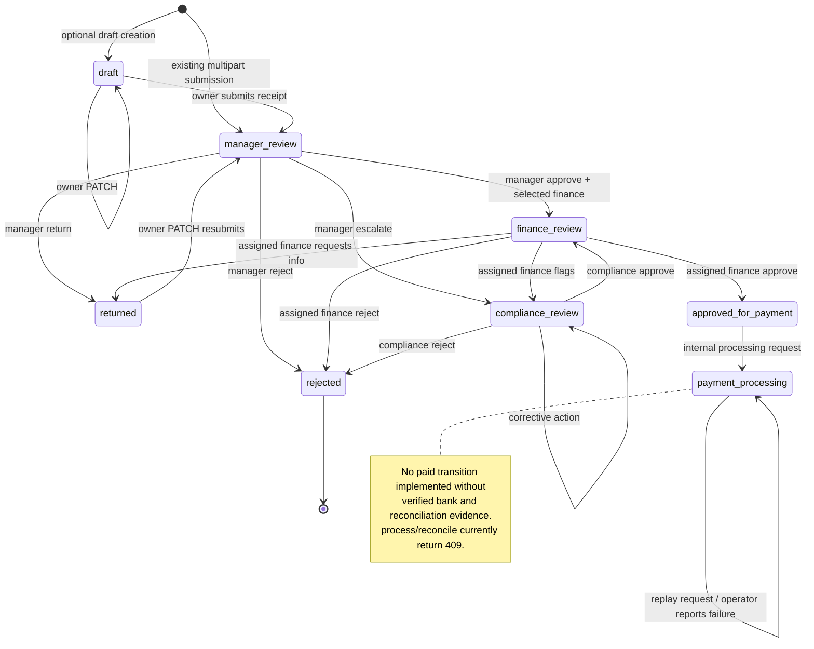

# Shared expense workflow persistence

Implemented on `feat/client-react-config-manager`, 2026-10-14. This is a backend integration handoff and an additive migration for review. No actor React components, AuthContext, router, Platform Admin logic, retained QA data, or common-base were changed. No commit, push, merge, reset, stash, rebase or Git clean was performed.

## Finding and persistence inventory

The reported gap was verified in the actual source, rather than inferred from the screens.

| Area | Before this change | After this change / boundary |
| --- | --- | --- |
| Tenant identity, organizations, hierarchy | PostgreSQL `TenantUser`, `Organization`, `managerId`; JWT authentication and tenant-role guards | Reused. Identity, role, active status and credential readiness are rechecked inside workflow writes. |
| Categories and policies | PostgreSQL `ExpenseCategory`, `ExpensePolicy`, configuration transactions | Reused. Category deletion checks durable expenses; composite FK also preserves references from soft-deleted expenses. |
| Versioned actor expenses | `TenantExpensesService` used `ExpensesRepository` → `store.expenses` | Prisma `Expense`; no fallback to the in-memory expense store. |
| Decisions and status history | Embedded mutable `ExpenseRecord.history` array | Append-only service writes to `ExpenseStatusHistory`, with sequence, actor UUID/role, previous/new stage, decision code and note. Existing history response shape remains. |
| Receipt bytes | `LocalFileStorageService`: UUID-named private JPEG/PNG/PDF files, signature/extension/size validation | Existing file validation and storage reused. Bytes remain on disk. No public static receipt route was found. |
| Receipt references | `ReceiptRepository` → `store.receipts` | Prisma `Receipt`, bound atomically to tenant and expense. Role and resource ownership checked before reading disk. |
| Versioned finance transactions | Delegated to legacy `TransactionsService` / `TransactionsRepository` → memory | Prisma `ExpensePayment`: internal processing requests, amount/currency, batch, requester, processing/failure timestamps and reserved bank/reconciliation evidence fields. |
| Notifications | PostgreSQL `TenantNotification`, but separate commits from expense mutation | Same table; workflow writes now join the expense transaction, with deduplication keys containing the transition sequence. Existing notification read/dismiss APIs remain. |
| Tenant audit | Configuration ledger was durable; legacy transaction audit was in memory; expense actor mutations lacked durable audit | Existing `TenantAuditLog` writer reused inside the expense transaction. No new competing audit domain. |
| Legacy `/expenses`, `/transactions` | Header-role APIs, seeded in-memory repositories | Preserved as separate legacy/demo interfaces. They cannot read the new Prisma expenses or receipt references. They are not the supported JWT actor integration path. |
| Legacy dashboard/reports | Aggregates over legacy repositories | Remain legacy/demo data; actor owners must use the versioned queues/workspace. This task does not rewrite these unrelated endpoints. |
| Cross-role tests | Mock-based tenant service tests, legacy receipt e2e, legacy node transaction tests; durable configuration/hierarchy/audit/notification e2e | Existing tests retained/adapted; new real PostgreSQL HTTP workflow tests and separate backend process restart checks added. |

The target architecture documents defer tenant modernization until Client V2. This task explicitly authorizes the shared tenant lifecycle persistence work. The implementation uses the canonical Organization and existing TenantUser, without changing control-plane billing or creating parallel organizations/users.

## Decisions reported before implementation; actor-owner review remains required

1. **Bank settlement:** the old versioned `process` and `reconcile` routes accepted no bank evidence and delegated to a sandbox that could mark expenses paid. Their paths remain, but they now return **409 `TENANT_BANK_EVIDENCE_REQUIRED`** after ownership validation. This is an intentional behavior incompatibility for any Finance UI that depended on simulated settlement. No paid outcome is fabricated. There is no operational payment provider integration in this slice.
2. **Approval sequence:** preserve Manager → Finance. Compliance is entered by manager escalation or Finance flagging; Compliance approval returns to Finance. No mandatory Compliance step was inserted.
3. **Policies:** configured `maxAmount`, `currency`, `approval`, `requiresApproval`, and `receiptRequired` fields were not applied by the versioned expense workflow. Multiple active policies per category are possible and no authoritative selection rule exists. Automatic limit enforcement, policy selection/version snapshots, receipt exemptions, or policy-driven routing require agreement. This implementation continues the existing mandatory receipt submission and active-category requirements. Client extraction confidence/risk/flag inputs are informational hints, not trusted routing decisions or verified AI results.
4. **Hierarchy changes:** manager decisions still require stored assignment AND current direct-report membership. A pending expense may become stranded after reassignment. Returned-expense PATCH still resubmits to the stored manager. No automatic rerouting or fallback was invented. New draft submission resolves the manager at submission time.
5. **Compliance routing:** retained active finance assignment is reused; otherwise the earliest-created active finance officer is selected, as in the existing implementation. Compliance cases are an organization-wide queue, not individually assigned. Owners must approve any replacement routing rule, unavailable-officer behavior or multilevel manager escalation.
6. **Failure/retry:** a failed internal processing request remains visible; release replay does not create a second payment attempt. A controlled retry-attempt contract and verified settlement/reconciliation contract require Finance/Submitter/Compliance agreement.

These are explicit integration gates. The migration has only been deployed to newly created disposable verification schemas, not retained QA or public data.

## Schema and transaction design

Additive migration: `prisma/migrations/20261014120000_shared_expense_workflow/migration.sql`.

New models:

- `Expense`: UUID, organization/employee/manager/finance/category ownership, Decimal(18,2) amount, currency, date, workflow stage, soft deletion, timestamps, optional submission idempotency key/fingerprint. `details` is an allowlisted compatibility projection of current decision fields and extraction hints; the decision ledger is authoritative history. Original date text is retained there so response date formatting does not change.
- `ExpenseStatusHistory`: UUID, parent organization/expense composite FK, unique expense/sequence, actor UUID/role snapshots, previous/new stage, event code/label/note and timestamp. There are no history update/delete APIs. Test fixture cleanup in an explicitly disposable schema is separate from application history operations.
- `Receipt`: UUID, organization/expense composite FK, one receipt per expense, private storage key, original filename, type, size and upload timestamp. Storage keys are not exposed by actor responses.
- `ExpensePayment`: UUID, organization/expense composite FK, one processing request per expense, Decimal amount/currency, batch, actor snapshot, status and timestamps, nullable bank reference/reconciliation metadata. Pending is an internal request, not evidence of transfer.

Only inverse relations were added to existing Organization, TenantUser and ExpenseCategory models. No existing table, category, policy, user, hierarchy, subscription, audit record, historical migration, historical FK or historical index is rewritten. New SQL checks constrain money, currency, stage/status, receipt size and settlement evidence. Composite foreign keys prevent cross-tenant parent/user/category references even if application validation regresses.

Every workflow mutation locks the canonical organization row, using the same ordering as hierarchy/configuration writes, then validates the current actor. Request-local AsyncLocalStorage carries the Prisma transaction; it is not a global connection/cache. Expense writes, history, notifications, receipt references and audit commit or roll back together. This conservative organization lock is suitable for the current modular monolith and prevents concurrent double decisions or hierarchy/assignment races. It serializes writes within a tenant; higher throughput and UI stale-view revision checks can be introduced later without changing owner isolation.

Receipt files are staged before the DB transaction. Failures, including transaction commit failure, remove the staged file. A process crash between disk write and DB commit can leave an unreferenced file; a scoped orphan cleanup job and durable/shared storage are deployment follow-ups. Disk and PostgreSQL do not form a distributed transaction. Soft deletion hides records from actor lists while retaining references, decisions and audit history.

Money is validated to two decimal places and a maximum `999999999999.99` for compatibility with existing numeric request/response contracts. Storage and payment-request copying use Decimal. `amountExact` is an additive fixed-two-decimal string in expense responses; clients should prefer it for exact display/export. No arithmetic aggregates or fabricated revenue/payment settlement are introduced.

## Exact actor API contracts

Base: `/api/v1/tenant/expenses`. All requests require `Authorization: Bearer <tenant-access-token>`. Identity, organization and role come from the backend JWT context. Role headers cannot grant access. Unknown JSON/multipart DTO fields are rejected by existing global validation; no frontend owner/status/decision fields are accepted in create/update bodies.

JSON success: `{ "success": true, "data": <result> }`. Errors retain `{ "success": false, "error": { "code": "...", "message": "..." }, "message": "...", "requestId": "..." }`, with requestId when available. POST succeeds with 201, GET/PATCH/DELETE with 200. Receipt success is binary, not wrapped JSON.

### Creation, draft and submitter

| Method/path | Actor | Body / result |
| --- | --- | --- |
| `POST /` | Expense Submitter | Existing multipart contract: `receipt` file plus required `amount`, `categoryId`, `merchant`, ISO `date`; optional `currency`, `notes`, `paymentMethod`, `receiptFileName`, `extractionConfidence`, `flag`, `riskScore`. The stored upload filename overrides receiptFileName. Returns ExpenseDto at `manager_review`. |
| `POST /drafts` | Expense Submitter | **Additive** JSON CreateTenantExpenseDto, same required fields; no receipt. Returns ExpenseDto at `draft`. An active reporting manager/category is required by the reused creation validation. Drafts are not shown in manager queue/history. |
| `POST /:id/submit` | Expense Submitter | **Additive** multipart `receipt` file only. Own draft required; validates active category/current reporting manager and atomically attaches receipt, records submission and notifies. Returns ExpenseDto at `manager_review`. Repeat submission returns 400. |
| `GET /mine` | Expense Submitter | ExpenseDto[] owned by the JWT employee; includes drafts, excludes soft-deleted records. |
| `PATCH /:id` | Expense Submitter | Partial CreateTenantExpenseDto. Own draft, manager_review or returned record only. Draft stays draft; editing returned automatically resubmits to manager_review, matching existing behavior. ReceiptFileName is display text; it cannot alter the authoritative stored receipt key/file. Returns ExpenseDto. |
| `DELETE /:id` | Expense Submitter | Own draft, manager_review or returned only. Returns `{id, deleted:true}`; durable soft deletion. |
| `GET /:id/receipt` | Supported tenant actors | Expense Submitter: own expense; Manager: stored assignment; Finance: assigned UUID; Compliance: current compliance review or prior compliance decision; Configuration Manager: same tenant. Foreign tenant returns 404; unrelated same-tenant actor returns 403. JPEG/PNG/PDF with existing safe Content-Disposition. |

Optional **`idempotency-key` header on existing POST /**: 1–100 letters, digits, `_` or `-`. It is scoped to organization/employee and persisted with a SHA-256 fingerprint of transformed DTO/file bytes. A matching replay returns the original expense, with no new receipt/history/notification/audit; differing payload or deleted original returns 409. Existing clients without this header remain supported; their separate submissions cannot be deduplicated safely without an agreed identity for the operation.

ExpenseDto preserves the existing fields:

```ts
{
  id, organizationId, employeeId,
  employee: { employeeId, fullName } | null,
  managerEmployeeId, assignedFinanceOfficerId: string | null,
  amount: number, amountExact: string, currency,
  categoryId, category, merchant, date, status, workflowStatus,
  notes, paymentMethod, receiptFileName,
  extractionConfidence?, flag?, riskScore?,
  managerDecision, managerDecisionAt?, managerDecisionNote?,
  financeDecision, financeDecisionAt?, financeDecisionNote?,
  complianceDecision, complianceDecisionAt?, complianceDecisionNote?,
  createdAt, updatedAt,
  history: [{ code, label, at, note }]
}
```

Decision responses retain `employee:null` and categoryId fallback where the existing transition projection does not load display names. Stage strings remain lowercase. Legacy `status` remains pending/approved/rejected, separate from workflowStatus. Missing optional properties are omitted during JSON serialization. Lists retain their array shape and are not paginated; a future pagination contract needs actor coordination.

### Review and finance

| Method/path | Actor | Input / result |
| --- | --- | --- |
| `GET /manager/queue` | Manager | ExpenseDto[]: stored assignment, current direct report, manager_review. |
| `GET /manager/history` | Manager | ExpenseDto[]: stored manager assignment, excludes manager_review and new unsubmitted drafts. |
| `GET /manager/finance-officers` | Manager | Active same-tenant `[{id,employeeId,fullName}]`. |
| `POST /:id/manager/approve` | Manager | `{financeOfficerId: UUID, note?:string}`; selected officer must be active in same tenant. ExpenseDto → finance_review. |
| `POST /:id/manager/return` | Manager | `{note?:string}` → returned. |
| `POST /:id/manager/reject` | Manager | `{note?:string}` → rejected. |
| `POST /:id/manager/escalate` | Manager | `{note?:string}` → compliance_review, clears finance assignment. |
| `GET /finance/queue` | Finance Officer | ExpenseDto[] at finance_review assigned to actor UUID. |
| `GET /finance/workspace` | Finance Officer | `{expenses: ExpenseDto[], transactions: TransactionRecord[]}` for actor-assigned expenses. |
| `POST /:id/finance/approve` | Finance Officer | `{note?:string}` → approved_for_payment. |
| `POST /:id/finance/reject` | Finance Officer | `{note?:string}` → rejected. |
| `POST /:id/finance/request-info` | Finance Officer | `{note?:string}` → returned; existing resubmission goes through Manager again. |
| `POST /:id/finance/flag` | Finance Officer | `{note?:string}` → compliance_review, retains finance assignment. |
| `GET /compliance/queue` | Compliance Officer | Organization-scoped ExpenseDto[] at compliance_review. |
| `POST /:id/compliance/approve` | Compliance Officer | `{note?:string}` → finance_review, with existing eligible officer or existing earliest-active fallback. |
| `POST /:id/compliance/reject` | Compliance Officer | `{note?:string}` → rejected. |
| `POST /:id/compliance/corrective-action` | Compliance Officer | `{note?:string}` records decision but remains compliance_review. Repeating the same corrective note is idempotent. |
| `POST /finance/payment-releases` | Finance Officer | `{expenseIds: UUID[]}` (1–100), all actor-assigned and approved_for_payment/payment_processing. Atomic; duplicates in request deduplicated. Returns existing `{batchId, expenses: ExpenseRecord[], transactions: TransactionRecord[]}` shape. New request moves expense to payment_processing, records pending processing request; replay reuses request UUID. No bank transfer performed. |
| `POST /finance/transactions/:id/process` | Finance Officer | Existing path, now 409 TENANT_BANK_EVIDENCE_REQUIRED for an owned request. |
| `POST /finance/transactions/:id/fail` | Finance Officer | Empty JSON body. Owned pending request → failed, durable audit/notification; repeating failed is idempotent. This records an authorized operator report, not a bank callback. |
| `POST /finance/transactions/:id/reconcile` | Finance Officer | Existing path, now 409 TENANT_BANK_EVIDENCE_REQUIRED. No paid transition without verified settlement. |

TransactionRecord preserves `{id, expenseId, employeeId, organizationId, amount:number, currency, merchant, categoryId, paymentMethod, status, transactionDate, processedAt?, createdAt, updatedAt}`. The payment request copies the exact persisted expense amount. Release expenses preserve the existing internal ExpenseRecord field names (including snake_case optional hints), rather than silently switching that batch contract to ExpenseDto.

Category/policy/template routes and notification routes are unchanged. No new role enums or platform permissions were introduced: the existing five tenant roles remain the authorization contracts. Wrong role yields 403, absent/invalid/inactive JWT identity 401, unavailable own-tenant state transitions 400, and foreign/unavailable resources 404. Changed cross-tenant lookups deliberately avoid revealing whether foreign UUIDs exist.

## Workflow transition diagram



Draft/manager_review/returned deletion is archival and preserves history; it is omitted from the state diagram for clarity. An unavailable finance officer rejects approval rather than assigning foreign or invented identities. Escalating when no active Compliance Officer exists preserves the existing unassigned organization queue; owners must decide whether to block escalation instead.

## Audit and notification events

Durable expense audit event codes: `expense.draft_created`, `expense.submitted`, `expense.updated`, `expense.deleted`, `expense.resubmitted`, `expense.manager_approved`, `expense.manager_returned`, `expense.manager_rejected`, `expense.manager_escalated`, `expense.finance_approved`, `expense.finance_rejected`, `expense.finance_requested_info`, `expense.finance_flagged`, `expense.compliance_approved`, `expense.compliance_rejected`, `expense.compliance_corrective_action`, `expense.payment_released`, and `expense.payment_failed`. Actor UUID/name/role and sequence/stage/money/assignment summaries are recorded using the existing tenant ledger. Review notes are in the expense history; receipt bytes, credentials and tokens are not copied to the audit ledger.

Existing actor event codes for notifications are retained. Release wording now states processing requested/awaiting verification rather than released to a bank sandbox. Successful decision retries cannot duplicate notifications: stage validation and organization locking serialize decisions; notification unique event keys and processing-request uniqueness add DB protection. Expense/history/audit/notification failures roll back the entire mutation.

## Verification evidence and repeatable commands

From `back-end`:

```text
node scripts/verify-expense-persistence.cjs
npm.cmd test -- --silent
npm.cmd run build
npm.cmd run typecheck
npm.cmd run prisma:validate
node --test test/transactions-lifecycle.test.js
```

The runner reads connection settings without printing credentials, always generates a fresh `finstack_config_verify_expense_<random UUID>` schema, builds the backend, runs `prisma migrate deploy`, and runs the new workflow suite plus configuration persistence, hierarchy, audit and notification e2e. No db push, reset, retained-schema migration or schema deletion is used. Isolated verification schemas and local test receipt directories are retained as evidence.

Verified scenarios include JWT ownership, correct manager queue, authorized review, selected finance assignment, Compliance via manager escalation and finance flag, corrective-action replay, return/resubmission, rejection visible to employee, durable processing/failure records, no fabricated settlement, duplicate submission with idempotency key, competing manager decisions, tenant/employee/assignment denials, private receipt access, exact Decimal persistence, invalid amount/currency/category, soft deletion, inactive identity, and atomic rollback on injected notification failure. Restart checks rebuild the Nest application and also start/stop **two separate backend OS processes** against the same isolated records and private upload directory.

The first regression run found a notification e2e fixture cleanup FK violation. That suite now deletes its disposable expense child fixtures before category/user cleanup. Retained application records are not deleted. Existing legacy expense and transaction repositories/tests remain separate.

Results and final verification schema are recorded in the completion note below. Repository-wide lint has pre-existing errors in `src/app.module.ts`, platform commercial/module/routes files and legacy middleware/receipt e2e files. Those unrelated files were not reformatted. The changed expense backend and affected e2e files receive a separate ESLint check.

Final verification on 2026-10-14:

| Check | Result |
| --- | --- |
| Full configured unit tests | 28 suites, 196 tests passed |
| Real PostgreSQL workflow + configuration/hierarchy/audit/notification e2e | 5 suites, 48 tests passed, including 9 new shared workflow tests |
| Separate backend OS processes | Both process starts read retained expense decisions, processing/failure metadata and protected receipts |
| Legacy transaction Node tests | 10 passed; sandbox behavior remains confined to legacy repositories |
| Backend build / typecheck | Passed |
| Prisma validate | Passed |
| Migration deployment | All 22 migrations applied successfully to a fresh isolated schema |
| ESLint for changed expense code/DTOs/unit test and affected e2e | Passed |
| Repository-wide lint | Failed with 34 pre-existing errors and 18 warnings in unrelated files; not claimed clean |
| git diff --check | Passed |

Final retained evidence schema: `finstack_config_verify_expense_e552bb509baa4cacad956879a53ae20d`. The runner used PostgreSQL on the configured local connection. Earlier verification schemas were also freshly generated and retained; none replaced retained QA/public schemas. The test runner never invokes the application bootstrap that rewrites Swagger output, preserving the pre-existing `docs/swagger.json` change.

## Safe integration plan and actor-owner follow-ups

1. Backend/DB owners review the additive migration, conservative organization lock, composite FKs and receipt deployment storage. Compare against the retained schema before deployment; do not repair unrelated historical FK/index drift in this migration.
2. Finance, Compliance, Manager and Submitter owners review the explicit gates above, especially 409 settlement behavior, routing/policy selection, manager reassignment and failed-attempt retry. Real settlement is not an acceptance claim for this slice.
3. Apply the reviewed migration to the intended retained environment using the team's normal `migrate deploy` release process after backup/review. Regenerate Prisma and deploy the backend together. Until migration deployment, the updated backend will require the new tables; do not point it at unmigrated QA/public data.
4. Actor owners integrate the versioned JWT endpoints using existing auth/router abstractions. Manager uses queue/history/finance-officers; Finance uses queue/workspace and displays a processing request as pending rather than paid; Compliance uses its queue/actions; Submitter uses mine/history/receipt and may opt into drafts/idempotency headers. No actor components were edited here.
5. Verify in the shared environment with actor-owned fixtures. Existing seeded in-memory demo expenses are not imported automatically; no reliable tenant/user/category mapping was established for them. If preservation is required, design a separately reviewed export/import with validated mappings rather than copying fabricated seed payments.
6. Configure persistent protected receipt storage with matching backend instances and backup; files are not stored inside PostgreSQL. Agree future retention/orphan cleanup, failed-payment retry, bank evidence ingestion/reconciliation, policy versions and pagination/stale-view contracts.

## Changed files

Created: the migration; `src/tenant/expenses/persistent-expenses.repository.ts`; `expense-workflow-context.ts`; `test/shared-expense-workflow.e2e-spec.ts`; `test/expense-process-harness.cjs`; `scripts/verify-expense-persistence.cjs`; this handoff document.

Modified: `prisma/schema.prisma` (new models/inverse relations), `src/data/store.ts` (additive draft type/optional amountExact only, legacy runtime unchanged), tenant expense service/controller/module/DTOs/unit tests, and notification e2e fixture cleanup. Existing configuration methods remain in the shared service, so its dependency changes and durable category-reference check are necessary shared-file changes. No frontend routes/pages were added or changed. The pre-existing modified `docs/swagger.json` and unrelated untracked artifacts were left untouched.
